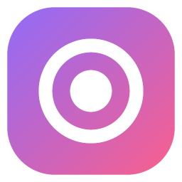
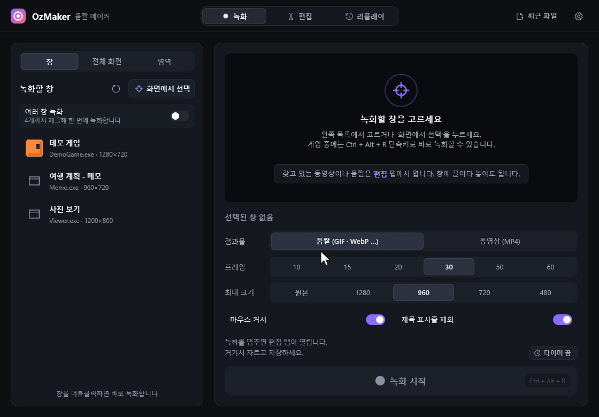
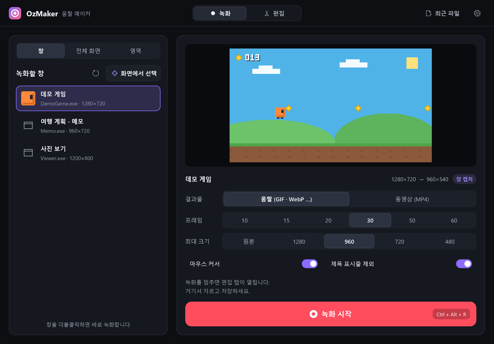
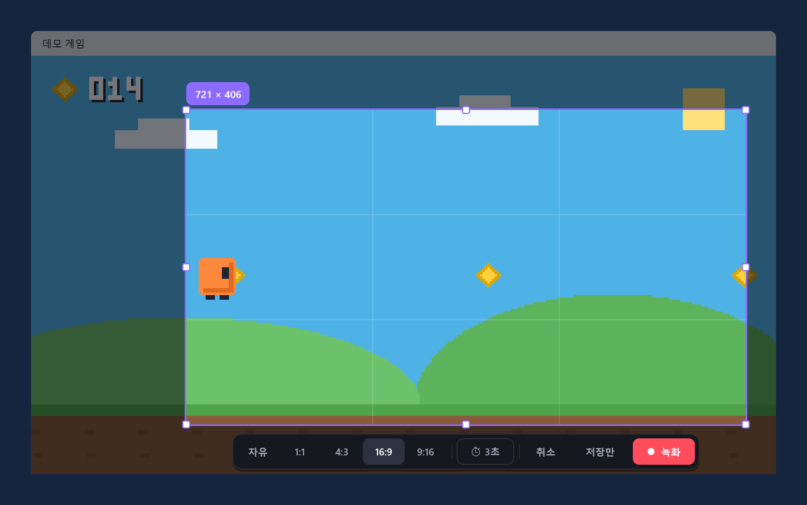
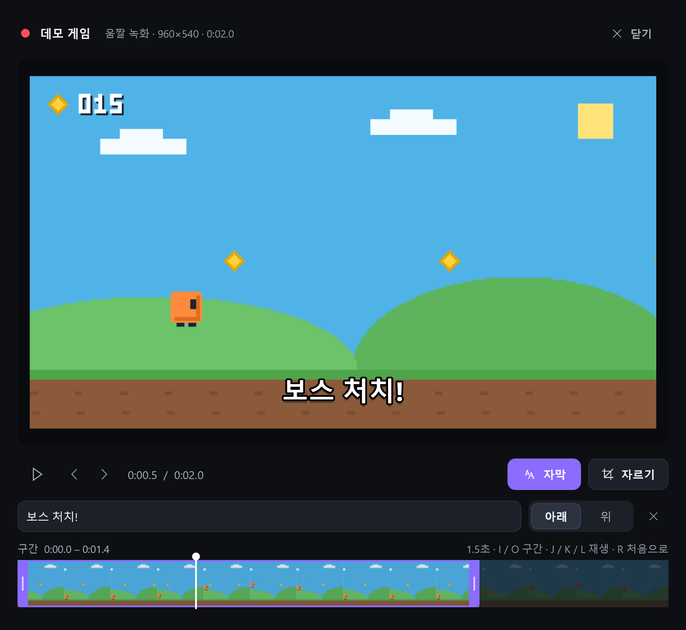
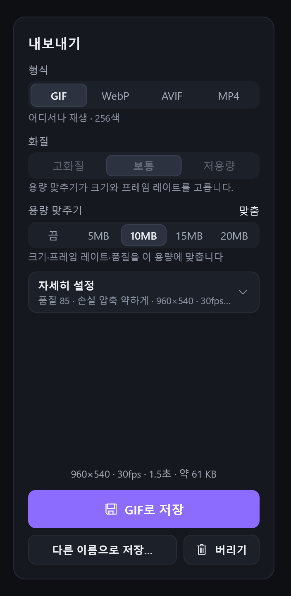

<h1 align="center">OzMaker</h1>

게임·프로그램 화면을 움짤(GIF · WebP · AVIF)과 MP4로 바로 만드는 Windows 녹화 도구

<a href="https://github.com/ejonghyuck/OzMaker/releases/latest"><b>⬇ 최신 버전 내려받기</b></a> Windows 10 · 11 (64비트) · 설치 없음 · 무료

 이 움짤도 OzMaker가 저장했습니다 · GIF · 1120×780 · 735 KB

> 처음 실행할 때 **“Windows의 PC 보호”** 창이 뜨면 **추가 정보 → 실행**을 누르세요. 코드 서명이 없는 프로그램이라 뜨는 창입니다.

## 할 수 있는 것

- **가려진 창도 그 창만** — 창 하나를 골라 그 창만 녹화하고, 그 창의 소리만 녹음합니다. 다른 창이 위에 올라와도 찍히지 않습니다.

  

- **원하는 영역만** — 화면에서 끌어서 영역을 정하고, 1:1 · 4:3 · 16:9 · 9:16 비율로 고정할 수 있습니다.

  

- **필요한 구간만 저장** — 구간, 화면 자르기, 크기, 속도를 정하고 자막 한 줄을 넣습니다. 움짤은 거꾸로 · 부메랑으로도 저장합니다.

  

- **올릴 곳의 용량에 맞춤** — 저장하기 전에 예상 용량을 보여 주고, 5 · 10 · 15 · 20MB를 고르면 그 안에 들어가게 저장합니다.

  

- **게임 중에는 단축키 하나** — `Ctrl + Alt + R`로 시작하고 멈춥니다. 전체 화면 게임을 내리지 않고 트레이 알림으로 끝났음을 알려 줍니다.
- **바로 붙여넣기** — **복사**를 누르면 파일이 클립보드에 들어가 메신저나 탐색기에 바로 붙여넣을 수 있습니다.
- **꺼져도 녹화가 남음** — 녹화 중에 OzMaker가 비정상 종료돼도 다음 실행 때 그때까지의 녹화를 되살립니다.

내 목소리(마이크)를 같이 녹음하거나, 마우스 클릭을 원으로 표시할 수도 있습니다. 갖고 있는 동영상을 열어 자르거나 움짤로 바꿀 수도 있습니다. MP4를 고화질 그대로 자르면 다시 인코딩하지 않아서 빠르고, 화질도 원본 그대로입니다.

## 시작하기

1. [최신 버전](https://github.com/ejonghyuck/OzMaker/releases/latest)에서 `OzMaker-<버전>-win-x64.zip`을 받아 압축을 풉니다.
2. `OzMaker.exe`를 실행합니다. 설치는 없습니다.
3. **녹화** 탭에서 녹화할 창을 고르고 **녹화 시작**을 누릅니다.
4. 움짤 녹화를 멈추면 **편집** 탭이 열립니다. 구간을 정하고 저장합니다. 동영상(MP4)은 멈추는 즉시 저장됩니다.

새 버전이 나오면 OzMaker가 알려 주고, 누르면 바꿔서 다시 시작합니다.

화면마다 자세한 설명은 **[사용 설명서](docs/guide.md)** 에 있습니다.

## 자주 묻는 질문

**“Windows의 PC 보호” 창이 떠요.**
코드 서명이 없어서 처음 실행할 때 뜹니다. **추가 정보 → 실행**을 누르세요. Windows 11에서 스마트 앱 컨트롤이 켜져 있으면 실행이 막힙니다(Windows 보안 › 앱 및 브라우저 컨트롤).

**게임이 검게 찍혀요.**
DX9 같은 오래된 전체 화면 게임은 검게 찍힐 수 있습니다. 게임을 테두리 없는 창 모드로 바꾸세요.

**녹화하는 창 둘레에 노란 테두리가 보여요.**
Windows 10이 녹화 중에 표시하는 것이고, 결과물에는 찍히지 않습니다. Windows 11에서는 보이지 않습니다.

**MP4로 저장이 안 돼요.**
Windows N 에디션이면 미디어 기능 팩을 설치해야 합니다.

**녹화한 파일이 어디로 보내지나요?**
아무 데도 보내지 않습니다. 녹화와 설정은 이 PC에만 남고, 인터넷은 GitHub에서 새 버전을 확인할 때만 씁니다.

**USB에 넣고 다니고 싶어요.**
`OzMaker.exe` 옆에 빈 `settings.ini` 파일을 만드세요. 설정이 그 파일에 저장되고, 이 PC의 시작 프로그램에는 등록하지 않습니다. 어느 설정 파일을 쓰는지는 설정 › 정보 › 설정 파일에서 볼 수 있습니다.

**지우려면 어떻게 하나요?**
트레이 아이콘에서 종료한 뒤 `OzMaker.exe`와 `%APPDATA%\OzMaker` 폴더를 지우면 됩니다.

그 밖의 제약은 [사용 설명서의 알려진 제약](docs/guide.md#알려진-제약)에 있습니다. 문제가 있으면 [이슈](https://github.com/ejonghyuck/OzMaker/issues)로 알려 주세요.

## 개발

빌드 방법, 동작 방식, 테스트용 명령줄은 [개발 문서](docs/development.md)에 있습니다.

## 라이선스

OzMaker는 [MIT 라이선스](LICENSE)로 공개합니다. 누구나 자유롭게 쓰고, 고치고, 배포할 수 있습니다. 빌드에 함께 들어가는 라이브러리는 [THIRD-PARTY-NOTICES.md](THIRD-PARTY-NOTICES.md)를 보세요.
